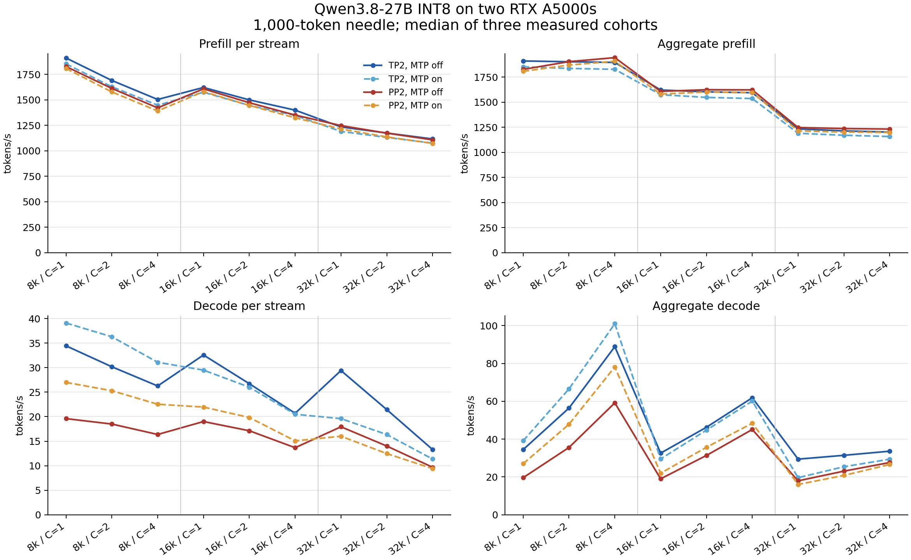

# Qwen3.8-27B INT8 on two RTX A5000s

The full TP=2/PP=2, MTP off/on, C=1/2/4 × 8k/16k/32k matrix completed on
2026-10-12. All 36 selected cells have clean measured GPU windows. TP=2 gave
higher decode throughput than PP=2 in every measured cell. One-token MTP
improved 8k decode in both topologies, but reduced TP=2 decode at 16k and 32k;
PP=2 gained at 16k and lost at 32k. These findings apply to this workload and
the fixed memory/serving profile below.

The checkpoint retains vision and MTP. The selected configuration uses
AllSpark W8A16 projections, native CUDA small-batch GDN decode and INT8 KV
insertion, existing FLA GDN prefill, and Triton paged full attention. Recurrent
state remains FP32. Speculative multi-token GDN verification uses the engine's
existing implementation. The model has no sparse indexer. INT8 cache storage
does not imply integer attention arithmetic.

The A5000 evaluation is complete; hardware release qualification remains
pending. No Hugging Face checkpoint release or production rollout is implied.

## Results and interpretation

The [CSV](a5000-2026-10-12.csv) contains separate per-stream and aggregate
prefill/decode rates. The complete table and measurement definitions follow
below. The plot is also available as [SVG](a5000-2026-10-12.svg).



At C=1, TP=2/MTP-off delivers 1,910.72 prefill and 34.45 decode tokens/s at
8k, versus PP=2's 1,826.83 and 19.61. At 32k/C=4, TP=2/MTP-off delivers
1,201.96 aggregate prefill and 33.62 aggregate decode tokens/s; per-stream
medians are 1,116.51 and 13.30. Aggregate throughput is measured from interval
unions and need not equal concurrency times the per-stream median.

These are absolute serving measurements. There was no end-to-end ablation
against an AllSpark-only configuration, so they do not establish the model-level
speedup caused by the native GDN/cache kernels. Large-row W8A8 microbenchmarks
improved projection speed, but the initial W8A8 configurations regressed a
vision fixture at C=4 and were excluded from this serving matrix. A later
[Nsight investigation](prefill-2026-10-12.md) found and fixed unintended W8A8
dispatch during decode and small prefills. The corrected policy passes the
full text/vision gate; this original matrix remains unchanged. Native GDN prefill was slower than the existing
implementation in the measured shapes and was also excluded.

## Quality and retrieval

The text check uses 32 disjoint 2,048-token WikiText-2 raw test windows at
dataset revision `b08601e04326c79dfdd32d625aee71d232d685c3`, with 65,504 scored
tokens after excluding the first token of each window. The maximum accepted
mean NLL increase is 0.02 nats/token. Vision uses the fixed 100-image AppMana
fixture set and rejects any newly incorrect case, even if aggregate accuracy
improves. The fixture SHA256 is
`bf5b1db963456ee19bba29f2c1d93be4ecf0900c94005350f26c4c4a92bf918b`.

| Configuration | Mean NLL | Increase over BF16 | Vision C=1 | Vision C=4 | New vision failures |
| --- | ---: | ---: | ---: | ---: | ---: |
| BF16 TP=2, MTP off | 1.951675 | — | 82/100 | Not run | — |
| INT8 TP=2, MTP off | 1.956562 | +0.004887 | 85/100 | 85/100 | 0 |
| INT8 TP=2, MTP on | 1.957279 | +0.005604 | 85/100 | 85/100 | 0 |
| INT8 PP=2, MTP off | 1.957258 | +0.005583 | 85/100 | 85/100 | 0 |
| INT8 PP=2, MTP on | 1.958002 | +0.006327 | 85/100 | 85/100 | 0 |

Raw exact-substring needle recall is **244/252** across the selected measured
requests. Exact whole-answer equality after removing outer whitespace is
**252/252**. Two prompts caused the raw misses in all four configurations:
8k/C=2, cohort 2/request 0 at depth 0.9, and 32k/C=4, cohort 2/request 2 at
depth 0.5. All words and punctuation were preserved; the difference is outer
whitespace. The additional diagnostic does not replace the original raw gate,
which remains false.

Replaying those two cohorts against the pinned BF16 source, with identical
prompts, seeds, depths and concurrency, produced the same raw misses: 1/2
at 8k/C=2 and 3/4 at 32k/C=4. All six BF16 answers matched after trimming
outer whitespace, and there were zero new raw or trimmed regressions.
This is a targeted comparison of the failed cohorts, not a complete BF16
throughput matrix. BF16 required CPU weight offload and eager execution; its
latency is not a resident-model performance baseline. The quality and retrieval
references used separate memory profiles appropriate to their workloads.

## Hardware and provenance

The host has two NVLink-connected RTX A5000 24-GB GPUs, driver 610.57.04,
ECC enabled and existing 230-W power limits. No power, clock or ECC settings
were changed. Each GPU reports 23,028 MiB total; driver reservations were
446 MiB and 444 MiB. Peak sampled GPU temperature was 88°C.

The lowest estimated free memory was 968 MiB for TP=2/MTP-off, 698 MiB for
TP=2/MTP-on, 652 MiB for PP=2/MTP-off, and **138 MiB for PP=2/MTP-on**.
These estimates subtract sampled used memory and the original server's
recorded driver reservation from total memory. They assume a constant driver
reservation and are not continuously sampled minima. The fixed 3.5-GiB KV
profile completed without OOM or preemption, but PP=2/MTP-on has very little
memory margin; this is not a production memory qualification.

The standing desktop process was retained and recorded. Four cells overlapped
brief RustDesk GPU activity and were repeated on fresh servers with the same
launch settings, prompts and seeds. The table selects their clean reruns.
Original attempts and their failed whole-server gates remain in the evidence
archive. The CSV's `selected_source` identifies each selected attempt;
`performance_window_valid` is the per-cell qualification, while
`original_configuration_gate` preserves the original combined server gate.
`interference_samples` counts the whole selected server's foreign activity;
activity outside a cell's measured window does not invalidate that cell.

| Artifact | Revision |
| --- | --- |
| Source checkpoint | [`Qwen/Qwen3.8-27B` at `1d4bf0f2ff6012fd82039f2fa52739d0dd7c60c0`](https://huggingface.co/Qwen/Qwen3.8-27B/tree/1d4bf0f2ff6012fd82039f2fa52739d0dd7c60c0) |
| vLLM serving source | [`0f7640c73b6f230eb58db05ca15bee7b8d6af12a`](https://github.com/AppMana/forks-vllm-consumer-nvidia-platforms/commit/0f7640c73b6f230eb58db05ca15bee7b8d6af12a) |
| Package/benchmark source | [`016ec328d7f07bf5363a94e1d04b7ff398b3610b`](https://github.com/AppMana/consumer-int8-kernels/commit/016ec328d7f07bf5363a94e1d04b7ff398b3610b) |
| Real upstream merge | [`c89fb48a97492ff5c84800fa41636839ab4d50c7`](https://github.com/AppMana/forks-vllm-consumer-nvidia-platforms/commit/c89fb48a97492ff5c84800fa41636839ab4d50c7), upstream `bfa7e5b7afe40ebe48288801a2baf5c1135cd881` |

The encoded checkpoint has 18 shards, 1,717 stored tensors and
30,420,299,488 tensor bytes: 408 language/MTP channel-INT8 modules and 110
vision group-32 INT8 modules. The encoder inventory, source revision and shard
checksums are preserved alongside the checkpoint. Language/MTP INT8 codes
are biased by +128 into UINT8 with BF16 channel scales; vision weights are
signed INT8 with FP32 group scales. Other tensors retain source precision.

## Reproduction

Use the pinned vLLM checkout's environment, with native dependencies built,
and the complete local encoded checkpoint:

```bash
<vllm-repo>/.venv/bin/python <consumer-int8-kernels>/benchmarks/run_matrix.py \
  --vllm-repo <vllm-repo> \
  --model <checkpoint-directory> \
  --output-dir <new-results-directory> \
  --kv-cache-memory-bytes 3758096384 \
  --linear-backend allspark \
  --gdn-backend consumer_int8 \
  --kv-writer consumer_int8
```

The launch profile uses maximum model length 33,536, four maximum sequences,
1,024-token chunked prefill, BF16 computation, packed per-token/head INT8 KV,
FP32 recurrent state and disabled prefix caching. It retains the vision tower,
allows one image per request with data-parallel vision encoding, and profiles
a 1,024-by-768 dummy image. MTP-on proposes one draft token per step.
Vision fixtures have maximum dimensions 800 by 548. Local text/vision quality
checks used vLLM `267ea06a038535783e4b4498dcfec1777b9d1a4d`; changes through
the benchmark's `0f7640c73b` are Docker metadata and documentation only.

The amd64 image at
`ghcr.io/appmana/vllm-consumer@sha256:ab11b9c33fc4bad182babe16f3d707144c58c1a678f078bb05bb67df2dd18fc7`
contains this package as an AOT wheel. Its installed package passed all 83
tests, and its PP=1 DeepSeek mini produced all 16 expected text/image outputs
across two fresh servers with zero runtime JIT events. This package test suite
contains both CUDA correctness and CPU metadata/harness tests. Image checks
are separate from the Qwen serving matrix collected in the editable environment.
An additional PP=2 image check failed fresh-server repeatability for the
one-image DeepSeek mini case: the first server differed from the editable
recording, while the second matched. All other image counts matched, and no
runtime JIT events occurred. This remains a failed check; the PP=1 result does
not qualify PP=2 image repeatability. Generated-token logprobs are unsupported
with PP-deferred speculative verification, so target-only margin diagnostics
use a different execution profile and cannot replace the failed check.
The target-only diagnostic also differed between two fresh image servers.
At the fourth output token, the editable runtime and second image favored
` is` over ` of` by 0.25 nats; the first image favored ` of` by 0.125 nats.
Each individual server repeated its own output. The cause remains unresolved.
ARM64/GB10 runtime, full 3090-chain acceptance, and checkpoint publication
remain release gates. The emulated ARM64 candidate build is not a substitute
for the documented native Spark build and runtime qualification.

## Complete throughput matrix

<!-- The table below is copied from the immutable local measurement report. -->

All rates are tokens/s. Stream and aggregate prefill/decode are measured separately from engine timestamps. Each completed cell has three measured cohorts after one discarded warmup. Prefix caching is disabled; prompts include the chat template. The passage is 1,000 tokens; the response allowance is 1,128 tokens, and rates use actual returned usage.

MTP-on runs propose one draft token per step.

Each table rate is the median of three cohort rates. Within a cohort, stream is the median per-request rate; aggregate divides all phase tokens by the union of their engine phase intervals. Decode excludes the first output token. These elapsed phase rates include scheduling gaps and contention with other requests, including simultaneous prefill. They are not isolated kernel or steady-state-only rates.

Hardware: this host's two NVLink-connected RTX A5000 24-GB GPUs, at the existing power and clock settings. The standing desktop remains active and is recorded in telemetry. Each GPU reserves 3.5 GiB for KV cache in every topology. TP=2 means PP=1; PP=2 means TP=1. Vision and MTP weights are retained, recurrent state is FP32, and the selected backends are AllSpark projections, native GDN decode/cache insertion, and Triton full attention.

Raw recall is the original exact-substring check. Trim recall requires exact whole-answer equality after removing outer whitespace only; it is an additional diagnostic and does not replace the original gate. Failed cases remain in the JSON records.

| Topology | MTP | Input | C | Prefill stream | Prefill aggregate | Decode stream | Decode aggregate | Raw recall | Trim recall | Timing |
| --- | --- | ---: | ---: | ---: | ---: | ---: | ---: | ---: | ---: | --- |
| tp2 | off | 8000 | 1 | 1910.72 | 1910.72 | 34.45 | 34.45 | 3/3 | 3/3 | clean rerun |
| tp2 | off | 8000 | 2 | 1690.07 | 1903.12 | 30.18 | 56.42 | 5/6 | 6/6 | clean |
| tp2 | off | 8000 | 4 | 1503.65 | 1896.26 | 26.27 | 88.90 | 12/12 | 12/12 | clean |
| tp2 | off | 16000 | 1 | 1621.46 | 1621.46 | 32.58 | 32.58 | 3/3 | 3/3 | clean |
| tp2 | off | 16000 | 2 | 1499.52 | 1603.39 | 26.73 | 46.28 | 6/6 | 6/6 | clean |
| tp2 | off | 16000 | 4 | 1398.90 | 1594.19 | 20.70 | 61.88 | 12/12 | 12/12 | clean |
| tp2 | off | 32000 | 1 | 1234.21 | 1234.21 | 29.41 | 29.41 | 3/3 | 3/3 | clean |
| tp2 | off | 32000 | 2 | 1174.42 | 1213.94 | 21.44 | 31.43 | 6/6 | 6/6 | clean |
| tp2 | off | 32000 | 4 | 1116.51 | 1201.96 | 13.30 | 33.62 | 11/12 | 12/12 | clean |
| tp2 | on | 8000 | 1 | 1852.69 | 1852.69 | 39.11 | 39.11 | 3/3 | 3/3 | clean |
| tp2 | on | 8000 | 2 | 1628.26 | 1836.38 | 36.30 | 66.55 | 5/6 | 6/6 | clean |
| tp2 | on | 8000 | 4 | 1447.43 | 1827.61 | 31.10 | 101.02 | 12/12 | 12/12 | clean |
| tp2 | on | 16000 | 1 | 1574.67 | 1574.67 | 29.50 | 29.50 | 3/3 | 3/3 | clean |
| tp2 | on | 16000 | 2 | 1445.53 | 1548.01 | 26.02 | 44.76 | 6/6 | 6/6 | clean |
| tp2 | on | 16000 | 4 | 1347.41 | 1536.46 | 20.49 | 60.12 | 12/12 | 12/12 | clean |
| tp2 | on | 32000 | 1 | 1190.29 | 1190.29 | 19.61 | 19.61 | 3/3 | 3/3 | clean rerun |
| tp2 | on | 32000 | 2 | 1131.43 | 1170.62 | 16.36 | 25.40 | 6/6 | 6/6 | clean |
| tp2 | on | 32000 | 4 | 1075.74 | 1157.90 | 11.36 | 29.39 | 11/12 | 12/12 | clean |
| pp2 | off | 8000 | 1 | 1826.83 | 1826.83 | 19.61 | 19.61 | 3/3 | 3/3 | clean |
| pp2 | off | 8000 | 2 | 1612.17 | 1904.21 | 18.50 | 35.58 | 5/6 | 6/6 | clean |
| pp2 | off | 8000 | 4 | 1421.17 | 1943.77 | 16.37 | 59.18 | 12/12 | 12/12 | clean |
| pp2 | off | 16000 | 1 | 1607.82 | 1607.82 | 19.01 | 19.01 | 3/3 | 3/3 | clean |
| pp2 | off | 16000 | 2 | 1471.76 | 1624.36 | 17.13 | 31.37 | 6/6 | 6/6 | clean |
| pp2 | off | 16000 | 4 | 1350.71 | 1622.69 | 13.68 | 45.10 | 12/12 | 12/12 | clean |
| pp2 | off | 32000 | 1 | 1247.52 | 1247.52 | 17.94 | 17.94 | 3/3 | 3/3 | clean |
| pp2 | off | 32000 | 2 | 1173.18 | 1237.44 | 14.01 | 23.07 | 6/6 | 6/6 | clean rerun |
| pp2 | off | 32000 | 4 | 1107.43 | 1232.43 | 9.68 | 27.62 | 11/12 | 12/12 | clean |
| pp2 | on | 8000 | 1 | 1807.45 | 1807.45 | 27.00 | 27.00 | 3/3 | 3/3 | clean |
| pp2 | on | 8000 | 2 | 1577.77 | 1870.18 | 25.29 | 47.85 | 5/6 | 6/6 | clean |
| pp2 | on | 8000 | 4 | 1390.98 | 1908.03 | 22.54 | 78.18 | 12/12 | 12/12 | clean |
| pp2 | on | 16000 | 1 | 1580.82 | 1580.82 | 21.96 | 21.96 | 3/3 | 3/3 | clean |
| pp2 | on | 16000 | 2 | 1445.36 | 1601.69 | 19.83 | 35.68 | 6/6 | 6/6 | clean |
| pp2 | on | 16000 | 4 | 1324.03 | 1596.47 | 15.07 | 48.40 | 12/12 | 12/12 | clean |
| pp2 | on | 32000 | 1 | 1214.32 | 1214.32 | 16.02 | 16.02 | 3/3 | 3/3 | clean |
| pp2 | on | 32000 | 2 | 1136.05 | 1202.17 | 12.48 | 20.82 | 6/6 | 6/6 | clean |
| pp2 | on | 32000 | 4 | 1072.81 | 1198.43 | 9.41 | 26.59 | 11/12 | 12/12 | clean rerun |

Timing validity is audited per cell against GPU telemetry, with a five-second margin around the measured window. Cells overlapping another compute process are repeated in a fresh server; `selected_source` records the chosen attempt. Original records and whole-server gate failures remain unchanged. Partial, interrupted, or overlapping cells are not qualified performance results.
