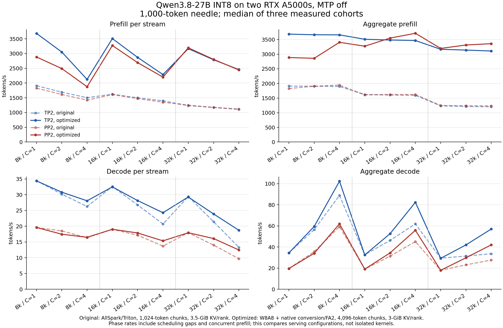

# A5000 prefill and OCR investigation, 2026-10-12

The reported OCR regression was caused by a local runtime dispatch defect.
The intended `consumer_int8_prefill` policy uses W8A8 only for at least 1,024
rows and AllSpark W8A16 for smaller requests. vLLM's guard-free AOT graph
reuse froze the Python branch selected while tracing 1,024 rows. Nsight
observed 62,464 activation-quantization launches at actual row counts from
1 through 729 during the 100-image C=4 evaluation. None should have occurred.

vLLM commit `7b5d852899` moves the branch inside an opaque custom operator,
where the actual tensor shape is read at execution time. A regression test
exports a graph at 1,024 rows, reuses it at 1, 4, 229 and 916 rows, and compares
against AllSpark exactly. It failed before the fix and passes afterward;
all 13 Qwen quantization tests pass.

## Model validation

The corrected prefill-only configuration uses Triton GDN/full attention and
the native INT8 KV writer, matching the previously failing configuration.
It runs on the same two A5000s, TP=2, MTP off, with 1,024-token chunks.

| Check | Result |
| --- | --- |
| Held-out tokens | 65,504, same fixed WikiText-2 windows |
| BF16 mean NLL | 1.9516748577 |
| Candidate mean NLL | 1.9591913585 |
| NLL increase / allowed maximum | 0.0075165008 / 0.02 |
| Vision C=1 / C=4 | 85/100 / 85/100 |
| Newly incorrect cases vs BF16 C=1 | 0 / 0 |
| Newly incorrect cases vs previous AllSpark at matching concurrency | 0 / 0 |
| Previously regressed `022-ocr.png` | `XU43J` at both concurrencies |
| Independent Nsight C=4 replay | 85/100, zero W8A8-only launches |

The post-fix trace contains 438,638 GPU kernel launches and no activation
quantization or AllSpark-weight restoration kernels. This verifies actual
dispatch rather than relying on the Python policy alone. BF16 C=4 was not
measured; these results do not establish universal batch invariance.

Evidence is retained under
`/home/administrator/Documents/appmana-benchmark-results/qwen3.8-prefill-2026-10-12/`:
`quality-runtime-dispatch/comparison.json`, the before/after
`ocr-*-dispatch-profile` directories, and `w8a8-dispatch-{red,green}.log`.
Original failed evaluation records remain unchanged.

## Existing upstream reports

- [Qwen GDN batch variance, vLLM #48613](https://github.com/vllm-project/vllm/issues/48613)
  concerns mixed prefill/decode and chunk boundaries. Its proposed
  [fix #49827](https://github.com/vllm-project/vllm/pull/49827) was open when
  checked and explicitly excludes quantized models, tensor parallelism and
  SM80 from its validated scope. It is a related issue, not the established
  cause of this local regression.
- [Qwen OCR discussion #61](https://huggingface.co/Qwen/Qwen3.8-27B/discussions/61)
  describes unwanted correction of source text. [Discussion #69](https://huggingface.co/Qwen/Qwen3.8-27B/discussions/69)
  reports multimodal weaknesses in quantized models with different setups.
  Neither provides a matching reproduction or an SM86 fix.
- [vLLM #60160](https://github.com/vllm-project/vllm/issues/60160) concerns
  high-concurrency FP8 accuracy with AMD AITER, a different backend and device.

## Prefill bottleneck

An Nsight Systems capture of warmed 8k and 32k requests on the original
AllSpark configuration attributed 45.1% of summed GPU kernel time to full
attention, about 41% to projections, and about 8% to NCCL. GDN prefill was a
small share. The two-GPU time sum is not request wall time.

At the isolated TP=2 shape (1,024 queries, 32,768 KV tokens, 12 query heads,
2 KV heads, D=256), the existing Triton full-attention tile takes about 41 ms.
Nsight Compute finds 225 registers/thread and 16.23% achieved occupancy,
with low DRAM traffic and a heavily used L1 memory instruction pipeline.
Larger Triton tiles reduce this to about 18 ms. The native packed-cache
candidate reaches about 17 ms and matches the reference with relative L2
error 0.00066. It passed the full NLL/vision gate with corrected W8A8 prefill
and native GDN/cache: NLL increase 0.0079994 and 85/100 at both concurrencies,
without any newly incorrect cases against BF16 or AllSpark.

Existing FlashAttention 2 on already-dequantized BF16 cache takes about
5.3 ms. That number excludes conversion and additional memory, and has
relative L2 error 0.00410 against the packed-cache reference. All kernel timings
above are normal-clock CUDA-graph measurements; NCU's clock-locked timings
are not used for those comparisons.

## Faster native conversion and fused projections

The package now converts active paged INT8 rows into temporary BF16 pages
using native CUDA, then invokes the installed FlashAttention 2. Conversion
plus attention takes 6.66 ms for the TP=2/C=4/32k microcase, versus 43.00 ms
for the original Triton kernel. The 256-MiB temporary contains one layer's
K/V only. The adapter caps scratch at 512 MiB/rank and falls back to direct
packed CUDA attention beyond that bound. Its 1,024-token-chunk model gate
passes: NLL increase 0.0070924, 85/100 vision at both concurrencies, no new
BF16 or AllSpark failures.

The next Nsight capture shows GEMM, weight restoration and separate output
scaling taking 38.5%, 10.4% and 6.5% of summed GPU kernel time. A CUTLASS
visitor now fuses row/channel scaling into the integer GEMM, retaining the
old multiplication order and BF16 channel scales. Outputs match exactly.
This removes the INT32 result buffer and a kernel launch. Ten Qwen projection
shapes improve by 1.17x at M=1024 and 1.21x at M=4096 before input quantization
and weight restoration; the largest PP=2 M=4096 projection saves 544 MiB.

Nsight Compute finds 230 registers/thread and four active warps/SM in the
initial fused tile (8.30% achieved occupancy). It is already using more than
80% of the measured compute and DRAM capability at NCU's locked clock.
The final schedule uses a 128x256x64 tile, eight warps and four stages for
M>=2048. Against the initial fused tile, geometric mean gains across ten
projection shapes are 1.05x, 1.08x and 1.15x at M=2048, 3328 and 4096.
Every tested output remains bitwise equal. Smaller rows keep their original
schedules. All 101 package tests and 13 Qwen quantization tests pass.

## Selected candidate validation

The candidate uses corrected W8A8 prefill, fused/tuned integer GEMM, native
GDN decode and INT8 cache insertion, FA2 with native cache conversion, and
4,096-token prefill chunks. MTP is off for this optimization comparison.

| Topology | Mean NLL | Increase over BF16 | Vision C=1 | Vision C=4 | New BF16/AllSpark failures |
| --- | ---: | ---: | ---: | ---: | ---: |
| TP=2 | 1.9641839202 | 0.0125090625 | 85/100 | 85/100 | 0 |
| PP=2 | 1.9569390573 | 0.0052641996 | 85/100 | 85/100 | 0 |

Both score the same 65,504 held-out tokens and retain the 0.02 NLL limit.
Evaluation uses a 1-GiB cache allocation to leave room for full-vocabulary
prompt log probabilities. Scoring with the 3-GiB serving cache ran out of
memory while gathering those logits; that failed attempt is retained.
Long-request serving capacity is checked separately without prompt scoring.

An 8,192-token chunk with 3.5-GiB KV/rank failed its first request with a
266-MiB allocation failure; that profile is rejected. The validated serving
candidate uses 4,096-token chunks and
a 3-GiB cache per rank. Both C=4/32k capacity checks passed. All 18
TP=2/PP=2 retrieval cells completed with clean timing and no new errors
against the original configuration, as detailed below.

The following are bounded diagnostic captures with eight output tokens,
not the requested 1,000-token retrieval benchmark. Each follows warmup:

| Configuration | 8k prefill tokens/s | 32k prefill tokens/s |
| --- | ---: | ---: |
| Original AllSpark/Triton, chunk 1024 | 1,957 | 1,249 |
| Corrected W8A8 plus native conversion/FA2, chunk 1024 | 2,868 | 2,656 |
| Fused projection scaling plus FA2, chunk 4096, before final tile tuning | 3,523 | 3,053 |

These measurements have not reached 5,500 tokens/s. That earlier trace attributes
50.5% of summed GPU kernel time to GEMM, 14.1% to attention and 13.3% to NCCL.
The full benchmark below reports prefill/decode and aggregate/per-stream
rates separately. Original baselines and failed experiments are preserved.

## Completed two-A5000 retrieval matrix

All 18 MTP-off cells completed with clean measured GPU windows, no preemptions,
and no serving OOM. Each cell has one discarded warmup and three measured
cohorts, at 8,000/16,000/32,000 prompt tokens and C=1/2/4. Each passage contains
1,000 tokens; the response allowance is 1,128, and rates use actual usage.
PP2 8k/C=4 was repeated after brief RustDesk GPU activity. The table selects
the clean rerun; original attempts are preserved.

Raw exact-substring recall is 122/126. Exact whole-answer
equality after removing outer whitespace is 126/126. There are no new failures
against the original INT8 configuration; every raw miss has the same output
as its preserved BF16 replay. The raw misses remain failures in the records.

Rates below are tokens/s, the median of three measured cohort rates. Within
a cohort, stream is the median per-request phase rate; aggregate divides all
phase tokens by the union of phase intervals. Decode excludes the first output
token. Scheduling gaps and simultaneous prefill are included, so these are
elapsed serving phase rates rather than isolated kernel timings.

| Topology | MTP | Input | C | Prefill stream | Prefill aggregate | Decode stream | Decode aggregate | Raw recall | Trim recall | Timing |
| --- | --- | ---: | ---: | ---: | ---: | ---: | ---: | ---: | ---: | --- |
| tp2 | off | 8000 | 1 | 3683.23 | 3683.23 | 34.39 | 34.39 | 3/3 | 3/3 | clean |
| tp2 | off | 8000 | 2 | 3052.63 | 3662.01 | 30.80 | 59.45 | 5/6 | 6/6 | clean |
| tp2 | off | 8000 | 4 | 2123.65 | 3658.64 | 28.07 | 102.32 | 12/12 | 12/12 | clean |
| tp2 | off | 16000 | 1 | 3507.62 | 3507.62 | 32.48 | 32.48 | 3/3 | 3/3 | clean |
| tp2 | off | 16000 | 2 | 2868.28 | 3482.62 | 28.14 | 52.61 | 6/6 | 6/6 | clean |
| tp2 | off | 16000 | 4 | 2288.02 | 3465.01 | 24.29 | 82.37 | 12/12 | 12/12 | clean |
| tp2 | off | 32000 | 1 | 3165.84 | 3165.84 | 29.27 | 29.27 | 3/3 | 3/3 | clean |
| tp2 | off | 32000 | 2 | 2789.07 | 3138.74 | 23.89 | 42.00 | 6/6 | 6/6 | clean |
| tp2 | off | 32000 | 4 | 2457.27 | 3106.81 | 18.71 | 57.05 | 11/12 | 12/12 | clean |
| pp2 | off | 8000 | 1 | 2883.98 | 2883.98 | 19.60 | 19.60 | 3/3 | 3/3 | clean |
| pp2 | off | 8000 | 2 | 2491.15 | 2857.57 | 17.46 | 34.04 | 5/6 | 6/6 | clean |
| pp2 | off | 8000 | 4 | 1874.81 | 3403.45 | 16.49 | 61.90 | 12/12 | 12/12 | clean rerun |
| pp2 | off | 16000 | 1 | 3272.04 | 3272.04 | 19.02 | 19.02 | 3/3 | 3/3 | clean |
| pp2 | off | 16000 | 2 | 2692.25 | 3548.04 | 17.86 | 34.42 | 6/6 | 6/6 | clean |
| pp2 | off | 16000 | 4 | 2201.09 | 3712.14 | 15.35 | 55.84 | 12/12 | 12/12 | clean |
| pp2 | off | 32000 | 1 | 3194.86 | 3194.86 | 17.93 | 17.93 | 3/3 | 3/3 | clean |
| pp2 | off | 32000 | 2 | 2802.64 | 3312.49 | 16.09 | 29.78 | 6/6 | 6/6 | clean |
| pp2 | off | 32000 | 4 | 2443.43 | 3357.69 | 12.46 | 42.06 | 11/12 | 12/12 | clean |

Aggregate prefill improves 1.50–2.72x across the 18 cells. The largest aggregate
decode slowdown is 4.3% at PP2, 8k/C=2. Operating conditions and phase scheduling
also differ; this run does not isolate the cause of that decode difference.
Within that cell's measured decode windows, median GPU0/GPU1 clocks changed
from 1,650/1,680 to 1,455/1,440 MHz, while median temperatures changed from
84/80 to 87/85 C. The local `phase-hardware-comparison.json` retains the
sample counts and conditions for every cell; overlapping prefill can be
included in those request decode windows.

The [CSV](prefill-2026-10-12.csv) preserves all four rate columns and accuracy
counts. The comparison changes the complete serving configuration: original
AllSpark/Triton used 1,024-token chunks and 3.5-GiB KV/rank; optimized W8A8/FA2
uses 4,096-token chunks and 3-GiB KV/rank. MTP is off in both plotted series.
The original 36-cell MTP-off/on report remains unchanged.



Both A5000s retain their existing 230-W limits and ECC configuration. The
smallest estimated sampled free-memory margin is 927 MiB for TP=2 and 402 MiB
for PP=2. This subtracts the original driver reservation from sampled usage;
it is not a continuous minimum. The largest measured temperature is 88 C.
No clocks, power limits or cooling settings were changed.

The matrix pins vLLM `a5665bc80b7db09bdc084decac6ef83f9b708b8f` and consumer-int8-kernels
`3740d6ad8013e2d898a0524d5865bd125fb6956e`. The loaded kernel extension SHA256 is
`62ea48c7688eaff7557d43fb1c142ea804bb9705a00ce63848f6dddefd0572ca`.
Later documentation commits do not alter these measured sources. Reproduce with:

```sh
<vllm-repo>/.venv/bin/python <consumer-int8-kernels>/benchmarks/run_matrix.py \
  --vllm-repo <vllm-repo> --model <checkpoint-directory> \
  --output-dir <new-results-directory> --topology tp2 pp2 --mtp off \
  --linear-backend consumer_int8_prefill --gdn-backend consumer_int8 \
  --kv-writer consumer_int8 --attention-backend consumer_fa2 \
  --max-num-batched-tokens 4096 --kv-cache-memory-bytes 3221225472
```

The final C=4/32k capacity trace attributes 46.7% of summed two-GPU kernel
time to GEMM, 17.6% to FA2 and 14.2% to NCCL. This is a short-output diagnostic,
not a decomposition of the table's wall time. At M=4096 the selected GEMM
schedule is within 1% of the fastest tested schedule for all ten projection
shapes. The current results remain below the requested 5,500-token/s target.

This qualifies the local two-A5000 MTP-off configuration. It does not complete
the separate ARM64/GB10, full 3090-chain or fresh-image PP=2 release gates.
The checkpoint remains unpublished. The optimized MTP-on configuration has
not been evaluated; the earlier MTP-on results apply to AllSpark/Triton.
